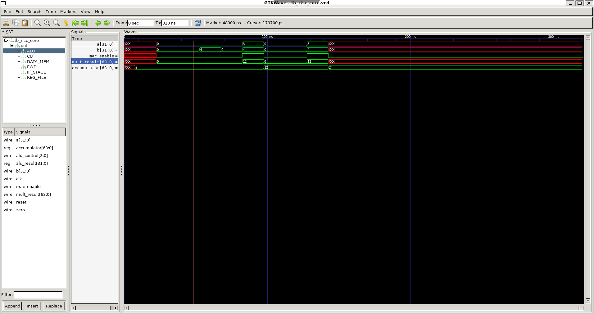
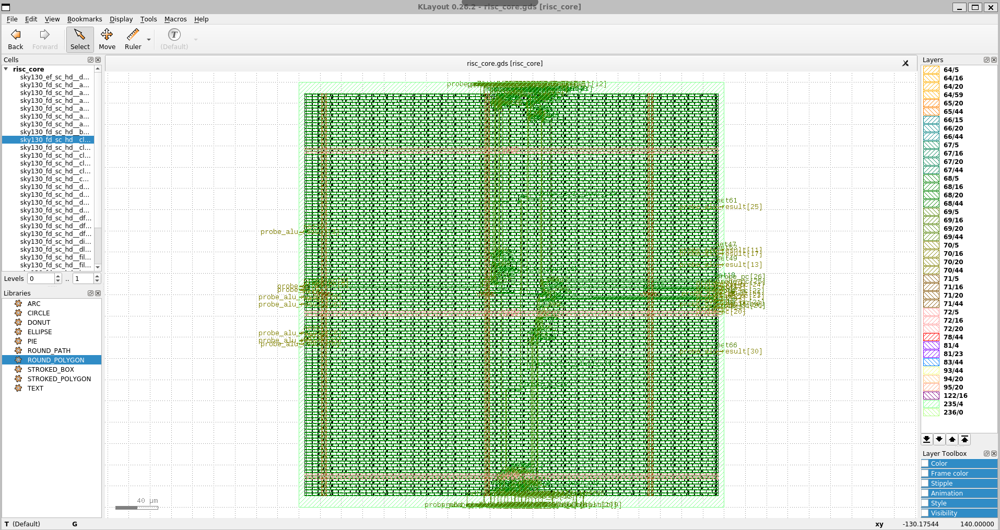

# 32-Bit 5-Stage Pipelined RISC Processor with Custom MAC (OpenLane 2 RTL-to-GDSII)

**Author:** Arpit Verma | B.Tech ECE, IIIT Ranchi  
**Domain:** RTL Design, Computer Architecture, ASIC Physical Design  

## Project Overview
This repository contains the complete Verilog RTL implementation and OpenLane 2 physical design configuration for a 32-bit,
 5-stage pipelined RISC processor (MIPS ISA). Moving beyond standard academic architectures, this core integrates
  modern microarchitectural enhancements including a custom Multiply-Accumulate (MAC) unit for DSP workloads and 
  a robust Data Forwarding Unit to resolve Read-After-Write (RAW) data hazards without pipeline stalling.

The project is structured for ASIC synthesis and physical design using the **OpenLane 2** flow, targeting 
standard cell libraries with custom physical constraints.

## Architectural Innovations
*   **Custom MAC Unit:** Expanded the standard ISA with a custom `MAC` opcode. The Execute stage integrates a 
     dedicated 64-bit hardware accumulator to compute `Accumulator = Accumulator + (A * B)` in a single clock cycle.
*   **Zero-Stall Data Forwarding:** Implemented a full forwarding network bypassing data from the MEM and WB stages 
     directly back to the EX stage, maintaining a CPI close to 1.
*   **ASIC-Optimized Initialization:** All sequential elements, including the Register File, feature explicit hardware resets 
     to prevent X-state propagation during RTL simulation and silicon initialization.
*   **Scalable RTL:** Parameterized data widths (`DATA_WIDTH = 32`) and local opcode definitions ensure clean, scalable, and 
     reusable Verilog code.

## Repository Structure
```text
VLSI_RISC_Project/
├── src/
│   ├── alu_with_mac.v       # Execute stage ALU with 64-bit accumulator
│   ├── forwarding_unit.v    # Hazard resolution network (EX and MEM hazards)
│   ├── register_file.v      # 32x32b ASIC-friendly register file with Reg 0 lock
├── images/                  # Waveforms, Synthesis Reports, and GDSII Layouts
├── config.json              # OpenLane 2 Physical Design constraints
└── README.md                # Project documentation

## Hardware Modules Completed

### 1. Execute Stage: ALU with MAC (`alu_with_mac.v`)
A parameterizable ALU that handles standard arithmetic/logic operations alongside a custom MAC instruction. The hardware multiplier `a * b` is decoupled as a continuous assignment, granting the synthesis tool (Yosys) maximum flexibility to map to optimized DSP/multiplier standard cells. 

### 2. Hazard Management: Data Forwarding Unit (`forwarding_unit.v`)
Resolves EX-stage and MEM-stage RAW hazards. Includes specific hardware logic (`rd != 0`) to prevent forwarding from Register 0, preserving the MIPS architectural standard where `$zero` is hardwired to 0.

### 3. Instruction Decode: Register File (`register_file.v`)
A 32x32-bit register file splitting combinational reads and sequential writes to align with the 5-stage pipeline timeline. Features a dedicated hardware lock `(write_reg != 5'd0)` to physically block rogue instruction overwrites to Register 0.

### 4. Instruction Decode: Control Unit (`control_unit.v`)
The main combinatorial decoder managing the datapath multiplexers and pipeline registers. It maps standard MIPS opcodes alongside the custom `MAC` instruction. 
*   **ALU Decoding:** Hierarchical decoding using the 6-bit `opcode` and 6-bit `funct` codes to generate precise 4-bit `alu_control` vectors.
*   **MAC Integration:** Drives a dedicated `mac_enable` control line that propagates to the Execute stage to sequentially clock the 64-bit hardware accumulator only when a MAC operation is strictly identified, conserving dynamic power during standard operations.

### 5. Instruction Fetch: PC & Branch Predictor (`instruction_fetch.v`)
The first pipeline stage responsible for managing the Program Counter (PC) and interfacing with the Instruction Memory (ROM).
*   **Dynamic Branch Prediction:** Integrates a 16-entry 1-bit Branch History Table (BHT). The BHT is indexed using the lower bits of the PC to predict if a branch will be taken, dramatically reducing pipeline flushes compared to static prediction models.
*   **Hardware-Level Corrections:** Features dedicated ports (`mispredict_flush`, `correct_pc`) to override the PC if the execution stage determines the BHT prediction was incorrect.
*   **ASIC Block RAM Inference:** Memory arrays are configured to cleanly infer SRAM macros during OpenLane synthesis, avoiding expensive and slow standard-cell registers.

### 6. Memory Access: Data Memory (`data_memory.v`)
Handles all `LOAD` and `STORE` operations in the pipeline's fourth stage. 
*   **Word-Aligned Addressing:** Hardware-level address translation mapping byte-addressable software pointers to physical 32-bit SRAM rows using combinatorial logic (`address[9:2]`).
*   **Single-Cycle Resolution:** Utilizes continuous assignments for memory reads to resolve data dependencies within a single pipeline cycle, aligning with standard MIPS timing requirements.
*   **SRAM Macro Inference:** Configured to map cleanly to foundry-provided SRAM macros during the OpenLane physical design flow, complete with deterministic reset states.

### 7. Top-Level Integration: Core Wrapper (`risc_core.v`)
The top-level structural Verilog module integrating the complete 5-stage datapath.
*   **Synchronous Pipeline Registers:** Implements explicit IF/ID, ID/EX, EX/MEM, and MEM/WB synchronous barrier registers. All control and data signals are actively pipelined to maintain correct execution state across varying combinational delays.
*   **Forwarding Multiplexer Network:** Physically instantiates the routing multiplexers that bypass the pipeline registers, directly feeding the outputs of the EX/MEM and MEM/WB stages back into the ALU operands to clear RAW hazards.
*   **Clean ASIC Boundary:** Encapsulated with only `clk` and `reset` as external pins, presenting a clean boundary for the OpenLane floorplanner and pin placement steps.

## Physical Design Constraints (OpenLane 2)
Due to the massive logic area and combinational delay introduced by the 64-bit hardware multiplier in the MAC unit, the default OpenLane physical constraints have been relaxed:
*   **Target Clock Period:** `15.0` ns (~66 MHz) to ensure timing closure and prevent setup slack violations on the MAC critical path.
*   **Core Utilization:** `40%` (Density `0.45`) to provide sufficient routing tracks for the dense 64-bit accumulator bus, preventing DRC short-circuit violations during detailed routing.


## Verification and Physical Synthesis Results

### 1. RTL Verification (Icarus Verilog & GTKWave)
The custom 64-bit MAC unit and forwarding logic were successfully verified using an instruction-level testbench. 
*   **Phase Hazard Resolution:** Implemented write-through internal forwarding in the Register File to resolve critical ID/WB phase hazards.
*   **Output:** The simulation confirms the 64-bit hardware accumulator correctly calculates sequential MAC operations (`3 * 4 = 12`, then `12 + 12 = 24`) without pipeline stalling.



### 2. ASIC Physical Design (OpenLane 2 RTL-to-GDSII)
The completed RTL was synthesized using the OpenLane 2 flow targeting the Sky130 PDK.
*   **Die Constraints:** Forced an absolute `400um x 400um` die area to provide sufficient routing tracks for the dense 64-bit accumulator bus, resolving initial OpenROAD PDN congestion.
*   **Synthesis Optimization:** Integrated explicit output probes (`probe_pc`, `probe_alu_result`) to prevent Yosys from aggressively optimizing away the internal pipeline logic.
*   **Final Signoff:** Achieved clean LVS and DRC checks, successfully routing the 32-bit RISC core and custom DSP logic.

